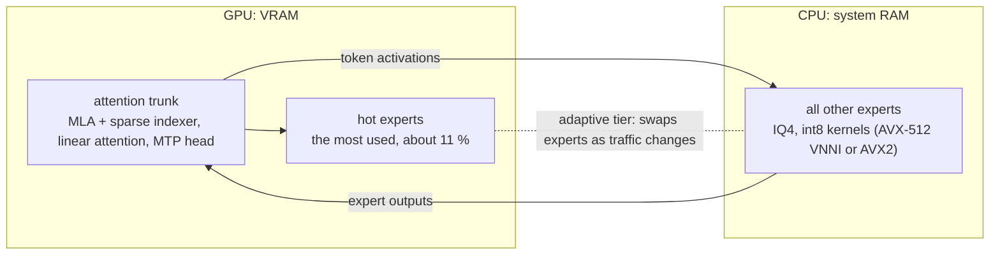

# Phobos

**GLM-5.3-Flash on one NVIDIA GPU plus system RAM: a local server for coding agents.**

A fork of [Strata](https://github.com/Niko1221/Strata) by Niko1221 and the Strata contributors.

[](LICENSE)
[](https://huggingface.co/zai-org/GLM-5.3-Flash)
[](https://huggingface.co/mussonking/GLM-5.3-Flash-Phobos-GGUF)

Phobos runs **GLM-5.3-Flash** (Z.ai's agentic coding model: 288 experts, 8 active per token) at 4 bits on a single
NVIDIA card and a large amount of system RAM. It serves a web chat and OpenAI / Anthropic compatible endpoints, so
Claude Code and other agents can use it. Nothing leaves your machine.

## Headline numbers

One Tesla V100 32 GB (PCIe 3), 2 x Xeon Gold 6252, 376 GB RAM, AVX-512 VNNI path, quiet machine:

| | measured |
|---|---|
| reading a long prompt (95 K and 113 K tokens) | **616-626 tokens/s** (113 K tokens in 181 s) |
| writing at 95-113 K tokens of context | **29-33 tokens/s** |
| writing, short context | **26 tokens/s** |
| first token of a follow-up turn (200 new tokens) | **1.1 s** |
| needle-in-a-haystack at 95 K and 113 K tokens | **6 / 6 found** |

- The long-context writing figures come from the needle answers, which are short and predictable: speculative
  decoding accepts most drafts there. Expect less on free-form writing.
- Under background load the same long prompts gave 21-25 tokens/s writing.
- Every figure, and the AVX2 path's, is in [docs/glm-public.md](docs/glm-public.md#how-fast-is-it).

## What it is

GLM-5.3-Flash is a mixture-of-experts model whose experts take ~165 GB at 4 bits: too much for any single consumer
GPU. Phobos keeps the attention trunk and the most used experts (1353 of them, 17.2 GB on our V100) on the GPU, and
leaves the other experts in RAM, where the CPU computes them with int8 kernels (AVX-512 VNNI, or AVX2). An adaptive
tier swaps experts in and out of VRAM as your traffic changes, and the model's own MTP head drafts tokens for
speculative decoding.



## Hardware

| | requirement | tested |
|---|---|---|
| GPU | NVIDIA, compute capability 8.0+ (RTX 30 / 40 / 50, A-series), 24 GB VRAM or more | **no 24 GB card tested yet** |
| | Tesla V100 (sm_70), experimental build | yes: the full model, every number above |
| | | RTX 3080 10 GB (sm_86), WSL2: a mini model only, all 18 checks pass |
| CPU | AVX2 minimum; AVX-512 VNNI (Xeon Cascade Lake+, AMD Zen 4 / Zen 5) is faster | VNNI and AVX2, on the same Xeon |
| RAM | 192 GB minimum, 256 GB+ better | 376 GB only |
| OS | Linux x86-64 | yes |
| | Windows through WSL2 | being verified (mini model passes) |
| Disk | ~180 GB free, NVMe | yes |

- RAM bandwidth sets the speed: each generated token reads ~3 GB of experts from RAM. A desktop with 2-channel DDR5
  should write roughly 10-15 tokens/s (projected, not measured).
- AMD AM4 and Intel LGA1200 boards take 128 GB at most, so they cannot run it. AM5 and LGA1700 / LGA1851 boards
  with 192 GB can.
- One GPU only: a second card is not used.

## Quick start

1. **Download** the IQ4 model, the expert profile and the tokenizer (179 GB):

   ```sh
   pip install -U huggingface_hub
   hf download mussonking/GLM-5.3-Flash-Phobos-GGUF \
       --include "GLM-5.3-Flash-Phobos-IQ4.gguf" "expert-profile-agent.strp" "tokenizer/*" \
       --local-dir /models/glm
   ```

2. **Build** the engine. You need the CUDA toolkit 12.x, a C++20 compiler and Python 3.10+.

   ```sh
   git clone https://github.com/mussonking/Phobos && cd Phobos
   python3 -m venv .venv && . .venv/bin/activate && pip install jinja2 cmake ninja
   cmake -B build -G Ninja -DCMAKE_BUILD_TYPE=Release -DSTRATA_ENABLE_CUDA=ON -DCMAKE_CUDA_ARCHITECTURES=86
   cmake --build build --target glm_serve
   ```

   - `CMAKE_CUDA_ARCHITECTURES` is your card's compute capability without the dot: RTX 30 = 86, RTX 40 = 89,
     RTX 50 = 120, A100 = 80.
   - V100: `70` plus `-DSTRATA_EXPERIMENTAL_SM75=ON`.

3. **Configure**: write `glm.json`.

   ```json
   {
     "exe": "build/src/glm/glm_serve",
     "args": ["--gguf", "/models/glm/GLM-5.3-Flash-Phobos-IQ4.gguf",
              "--profile", "/models/glm/expert-profile-agent.strp",
              "--ctx", "131072", "--sessions", "2", "--kv-latent", "auto", "--spec", "1",
              "--prefix-cache-gb", "48"],
     "tokenizer": "/models/glm/tokenizer",
     "family": "glm",
     "model_name": "glm-local",
     "fit_max_tokens": true,
     "log": "glm-serve.log"
   }
   ```

   With 192 GB of RAM, use `"--prefix-cache-gb", "0"`.

4. **Start** the server:

   ```sh
   STRATA_API_KEY=<a key you choose> .venv/bin/python -m serve.server --engine strata --config glm.json --port 8142
   ```

   Loading takes a few minutes (~2 min from NVMe on our machine); `curl http://127.0.0.1:8142/health` answers once
   it is ready.

5. **Chat**: open `http://127.0.0.1:8142/` in a browser. Or point Claude Code at it:

   ```sh
   export ANTHROPIC_BASE_URL=http://127.0.0.1:8142 ANTHROPIC_API_KEY=<your key>
   export API_TIMEOUT_MS=3600000 CLAUDE_CODE_MAX_OUTPUT_TOKENS=8192
   claude
   ```

Every option, the endpoints, thinking effort and the prefix cache: [docs/glm-public.md](docs/glm-public.md).

## Known limits

- **Untested on 24 GB cards and on desktops.** Every full-model number comes from one V100 server.
- Greedy decoding only: temperature, top-p, top-k and seed are ignored.
- One GPU. One request generates at a time; others wait in line.
- Text only: GLM-5.3-Flash reads images, this engine does not.
- The AVX2 path's first token is slow on PCIe 3 (12-16 s for a 200-2000-token follow-up), because it uploads the
  prompt's experts to the GPU.
- GLM always thinks. A request with no effort gets Max, which can think for minutes: set `reasoning_effort` to
  `low` or `high`, and a `max_tokens` large enough for the thinking plus the answer.
- 131072 tokens per conversation is the most we tested.

## Roadmap

- **Q3 and an experimental Q2** of the experts, for gaming PCs with 64 GB of RAM, a 16-24 GB GPU and an NVMe drive
  holding the experts that do not fit in RAM. The measurement is under way; no numbers are promised until they are
  measured. They will join the IQ4 file in the same
  [Hugging Face repo](https://huggingface.co/mussonking/GLM-5.3-Flash-Phobos-GGUF).
- Results on 24 GB cards and desktops, from your reports (below).

## Report a test

Tested it on a 3090, a 4090, another 24 GB card, a desktop or WSL2? Open an issue titled
`test: <GPU> / <CPU> / <RAM>` with:

1. **Your setup:** GPU and VRAM, CPU model, RAM size and type (channels, speed), OS; for WSL2, the Windows build and
   the RAM given to WSL.
2. **`/health`:** the JSON from `curl http://127.0.0.1:8142/health` once the server is ready. It has `cpu_isa` (the
   CPU kernel path: `vnni`, `avx2` or `scalar`), `kernels`, `arena` and `slots` (experts in VRAM).
3. **The engine log** (the file named by `"log"` in your config): CPU threads, VRAM slots, load time, and one timing
   line per request.
4. **The needle results:** 6 long prompts (95 K and 113 K tokens) with a code word hidden in each, ~20 min:

   ```sh
   hf download mussonking/GLM-5.3-Flash-Phobos-GGUF --include "needles/*" --local-dir /models/glm
   .venv/bin/python tools/glm/needle_http.py /models/glm/needles --url http://127.0.0.1:8142 --key-file <file with your key>
   ```

   Paste its output: `FOUND` or `missed` per prompt, and the final `N/6 found` line.
5. **If it failed:** the last 50 lines of the engine log and of the server output.

## Credits

Phobos stands on other people's work:

- **[Z.ai](https://huggingface.co/zai-org/GLM-5.3-Flash)**: GLM-5.3-Flash, its weights, tokenizer and chat template
  (MIT, Copyright (c) 2026 Z.AI Co., Ltd). GLM-5 technical report: [arXiv:2602.15763](https://arxiv.org/abs/2602.15763).
- **[Strata](https://github.com/Niko1221/Strata)** by Niko1221 and the Strata contributors (MIT): the project this
  repository forks. Its server, web app, tokenizer tools and build system are the base Phobos runs on; upstream's own
  README and credits are in [docs/STRATA-README.md](docs/STRATA-README.md) and
  [docs/DETAILS.md](docs/DETAILS.md#credits-and-licenses).
- **[unsloth](https://huggingface.co/unsloth/GLM-5.3-Flash-GGUF)**: the BF16 GGUF conversion our IQ4 file was
  quantized from, and the importance matrix used to quantize it (MIT).
- **[llama.cpp / ggml](https://github.com/ggml-org/llama.cpp)** and their authors (MIT):
  - the IQ4_XS / IQ4_NL formats and their codebooks, reused in our GPU and CPU expert kernels
    (`third_party/ggml/LICENSE`), and the Q8_K rounding our CPU kernels reproduce;
  - `llama-quantize`, which made the GGUF, and `llama-imatrix`, which measured our expert profile;
  - the `glm5-next` model implementation, the reference our forward pass was written from and checked against
    ([docs/glm5next-spec.md](docs/glm5next-spec.md)); the MTP draft head follows llama.cpp PR #27917;
  - ggml's reference kernels, which our kernel parity tests compare against.
- **The research behind GLM-5.3-Flash's architecture**, which this engine implements:
  - Multi-head Latent Attention: DeepSeek-V2, [arXiv:2405.04434](https://arxiv.org/abs/2405.04434);
  - DeepSeek Sparse Attention and its lightning indexer: DeepSeek-V3.2,
    [arXiv:2512.02556](https://arxiv.org/abs/2512.02556);
  - Kimi Delta Attention: Kimi Linear (Moonshot AI), [arXiv:2510.26692](https://arxiv.org/abs/2510.26692), which
    extends Gated DeltaNet, [arXiv:2412.06464](https://arxiv.org/abs/2412.06464);
  - manifold-constrained hyper-connections: mHC (DeepSeek), [arXiv:2512.24880](https://arxiv.org/abs/2512.24880),
    after Hyper-Connections (ByteDance), [arXiv:2409.19606](https://arxiv.org/abs/2409.19606).
- **NVIDIA CUB** (CUDA toolkit): the radix sort in the prefill path.
- **Outfit** font in the web app (SIL Open Font License 1.1, `serve/web/fonts/OFL.txt`).

Related work, no code shared:

- [sergqwer/strata-glm](https://github.com/sergqwer/strata-glm): another Strata fork for GLM-5.3-Flash, running the
  checkpoint's NVFP4 experts on an RTX 5090 with 128 GB RAM and 2 NVMe (15-18 tokens/s per its README; archived).
- [glm53-flash-offload](https://github.com/sybil-solutions/glm53-flash-offload) by 0xSero: exllamav3 with EXL3
  3.05 bpw and expert offload, on an RTX 3090 with a 24-core EPYC.

Phobos is not affiliated with or endorsed by Z.ai, unsloth, the llama.cpp authors or Strata's author.

## License

MIT, see [LICENSE](LICENSE): Copyright (c) 2026 Niko1221 and the Strata contributors; Copyright (c) 2026 mussonking
(GLM-5.3-Flash engine). The model weights on Hugging Face are Z.ai's, under MIT.
